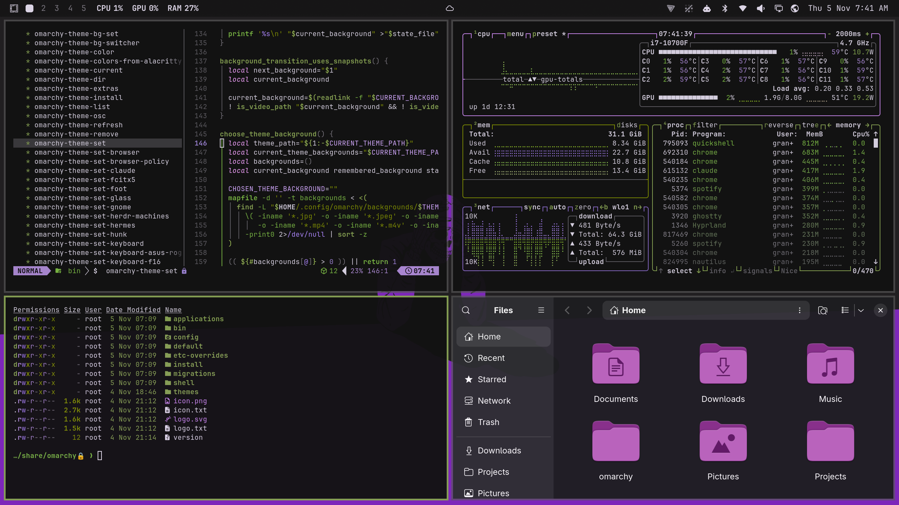

# Sad Skeleton

A dark [Omarchy](https://omarchy.org/) theme: purple, moss green and a skeleton having a hard time.


## Install

```bash
omarchy theme install https://github.com/grant018/omarchy-sad-skeleton-theme
```

Built and tested on Omarchy 4.5.

## What's in it

- **Three wallpapers**, 4K: purple (the default), red and bone. Cycle through them with `omarchy theme bg next`.
- **An animated intro for each wallpaper**: the figure draws itself in the dark, one tear falls, and the color floods out across the floor from where it lands. It ends on the exact wallpaper, so the handoff is invisible.



The intros play when you switch to the theme and at startup. They're 5 seconds, 60 fps and silent. To turn them off, run `omarchy theme bg intro disable`.

## License

The theme's configuration files are [MIT licensed](LICENSE). The license doesn't cover the artwork or the intro clips made from it.
